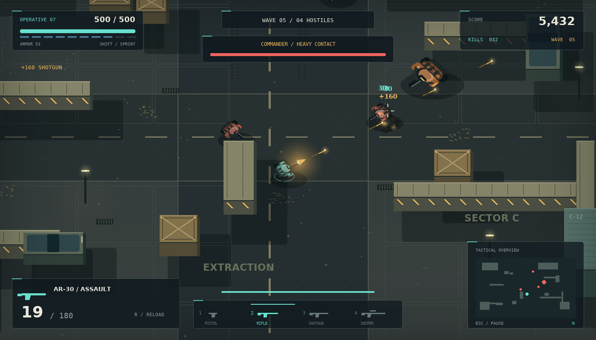

# AI Militia: Combat Zone

A playable Python/Pygame arena shooter rebuilt from the supplied `militia.py`, with a tilted **2.5D** battlefield, four weapons, tactical enemies and a complete interface.



## Run on Windows

Install Python 3.10 or newer, extract **the entire ZIP**, and open a terminal in the `AI_Militia` folder containing `main.py`. These commands use an isolated environment and do not require PowerShell activation:

```powershell
py -m venv .venv
.\.venv\Scripts\python.exe -m pip install -r requirements.txt
.\.venv\Scripts\python.exe main.py
```

You can also run `.\.venv\Scripts\python.exe militia.py`; it launches the same upgraded game. Keep all folders together. The new `militia.py` is a compatibility launcher, not a standalone copy of the game.

## Run on Linux or macOS

```bash
python3 -m venv .venv
.venv/bin/python -m pip install -r requirements.txt
.venv/bin/python main.py
```

The only third-party dependency is **pygame-ce 2.5.8**, imported as `pygame`. NumPy and an external game engine are not required. The virtual environment prevents an older `pygame` installation from conflicting with `pygame-ce`.

## Controls

| Control | Action |
|---|---|
| W/A/S/D or arrow keys | Move |
| Mouse | Aim |
| Hold left mouse button | Fire |
| R | Reload; retry after defeat |
| Shift | Sprint, using stamina |
| Space | Dodge in movement direction; aim direction when standing |
| 1 / 2 / 3 / 4 | Pistol / assault rifle / shotgun / sniper |
| Mouse wheel | Cycle weapons |
| Esc or P | Pause / resume |
| F11 | Fullscreen / windowed |
| 1 / 2 / 3 between waves | Choose a field upgrade |

Sprint and dodge temporarily prevent firing. Dodging gives 0.20 seconds of invulnerability and has a cooldown. A holstered weapon cancels its unfinished reload. An empty magazine automatically reloads when you keep firing; use R to reload early.

## Missions and combat

- **Operation: Iron Veil** has ten waves, with bosses on waves 5 and 10. Defeat every hostile in wave 10 to complete the mission.
- **Endless Survival** retains the original endless arena concept. Pressure increases with each wave, with a boss every fifth wave.
- The player starts with the original **500 health**, plus 75 armor. Armor absorbs part of incoming damage. Cover blocks movement and bullets for both teams.
- The three original enemy archetypes remain: regular soldier, shotgun bot and sniper. Runners, heavies and commanders add variety. Enemies navigate using A*, maintain firing distance, strafe, retreat and seek cover at low health. A sniper's laser warns you before its shot.
- Between waves, all four weapons refill; you recover 45 health and 25 armor and can select one of three upgrades. Some defeated enemies drop ammo or medkits.
- Kills, precision kills and wave clears award points. Kills within three seconds build a small chain bonus. Accuracy counts each trigger pull once, including an eight-pellet shotgun shot, and cannot exceed 100%.
- A centered sniper hit earns a **precision bonus**, rather than pretending the overhead art has a separately modeled anatomical headshot hitbox.

| Weapon | Damage | Magazine | Reload | Role |
|---|---:|---:|---:|---|
| P9 pistol | 42 | 14 | 1.05 s | Accurate sidearm, unlimited reserve |
| AR-30 rifle | 30 | 30 | 1.55 s | Automatic general-purpose weapon |
| SG-8 shotgun | 23 × 8 pellets | 8 | 1.90 s | Strong close-range spread; short pellet lifetime |
| SR-5 sniper | 180, ×1.4 on center hits | 5 | 2.25 s | Slow, precise, fast projectile |

Values above are before field upgrades. Movement and accumulated recoil widen spread. The actual crosshair stays under the cursor; the Aim Response setting changes the speed at which your operative rotates towards it.

## Graphics and audio

This is a **2.5D Pygame game**, not a true 3D engine migration. An angled ground projection, raised roofs, depth-sorted characters, directional shadows, camera tracking, recoil, particles, muzzle lighting, dust and parallax create depth while keeping the original mouse-aimed arena gameplay.

Graphics, ambient music and sound effects are generated in code, with bundled licensed fonts. You do not need `Background.png`, `user.png`, `regular.png`, `short.png`, `sniper.png` or `object.png` to launch. Missing or malformed optional assets fall back safely; an unavailable audio device does not prevent play.

The **Settings** page saves resolution, fullscreen, effects quality, shake, master/music/SFX volume, aim response and difficulty. Difficulty takes effect on a new mission. Low quality reduces glow, airborne dust and particle counts; collision rules and enemy behavior remain the same.

### Replace graphics

Put transparent PNGs in `assets/images/`. Orient the art **facing right**, with the character centered in a square tile; allow room for its gun. Source images can be larger than 86 × 86; they are normalized and cached.

- Static actor files: `player.png`, `soldier.png`, `shotgun.png`, `sniper.png`, `runner.png`, `heavy.png`, `boss.png`.
- Weapon-specific art: for example, `player_rifle.png`, `player_pistol.png`, `player_shotgun.png`, `player_sniper.png`.
- Optional animation strips: `player_walk.png`, `player_idle.png`, `player_fire.png`, `player_reload.png`, `player_dodge.png`, `player_death.png`, and the same states for enemy names. Each strip is one horizontal row of equally sized square frames, up to 32 frames; default speed is 10 frames/second. Death clips stop at the last frame.

Static art uses procedural foot movement, muzzle effects, reload indicators and falling/fading corpse animation. Animation-strip overrides can replace these poses. Environment layout and materials are in `world.py` and `renderer.py`; there is no requirement to obtain a separate tile pack.

### Replace audio

Add `.ogg`, `.wav` or `.mp3` files using the following stems in `assets/sounds/`:

`pistol`, `rifle`, `shotgun`, `sniper`, `reload`, `impact`, `hurt`, `kill`, `explosion`, `menu`, `dodge`, `victory`, `game_over`.

Put a looping `ambient.ogg` or `ambient.wav` in `assets/music/` to replace the synthesized ambient track. Assets load once on startup. Restart after replacing a file.

### Replace fonts

The bundled `Interface.ttf`, `Heading.ttf` and `Telemetry.ttf` are DejaVu fonts; their license is included alongside them. Fonts can be replaced with appropriately licensed TTF files using those names. Missing fonts fall back to a system font.

## Saves and Continue

Settings, high score, completed mission count and the current checkpoint use atomic JSON writes. Checkpoints preserve the player, weapons, enemies, projectiles, pickups, wave and statistics. They save every 20 seconds, on wave transitions, on pause, on returning to the menu and on quit. Enemy navigation paths and short cosmetic effects regenerate on Continue. A sniper telegraph regenerates safely rather than firing immediately on load.

Windows save location: `%LOCALAPPDATA%\AI_Militia\save.json`. Other systems use `$XDG_DATA_HOME/AI_Militia/save.json` when set, otherwise `~/.ai_militia/save.json`. Corrupt or missing data restores defaults or discards the invalid checkpoint safely. A completed or failed run clears Continue while preserving the high score.

For a portable custom location:

```bash
python main.py --save-dir ./user_data
```

## Project structure

| File / folder | Responsibility |
|---|---|
| `main.py`, `militia.py` | Application entry and compatibility launcher |
| `game.py` | State machine, fixed-step simulation, combat and checkpoints |
| `config.py` | Window, world, palette and settings defaults |
| `player.py`, `enemy.py`, `weapons.py`, `bullet.py` | Movement, AI, firearm state and swept collision |
| `world.py`, `camera.py`, `renderer.py`, `assets.py`, `particles.py` | Arena, projection, procedural art, cached drawing and effects |
| `ui/interface.py` | Menu, HUD, settings, pause, upgrades and result screens |
| `systems/` | Navigation, audio, animations, progression and persistence |
| `assets/` | Fonts and optional image/audio overrides |
| `tests/` | Behavioral tests, actual-screen captures and stress harness |
| `docs/` | Change notes, verification evidence and screenshots |

## Verify

```bash
python -m unittest discover -s tests -v
python tests/verify_release.py --output release-check
python main.py --headless --demo game --frames 120 --capture preview.png
```

The tests use SDL dummy video/audio drivers and temporary saves. Preview commands also use temporary saves so they do not overwrite your mission. See `docs/VALIDATION.md` for the checks actually run and their limits.
